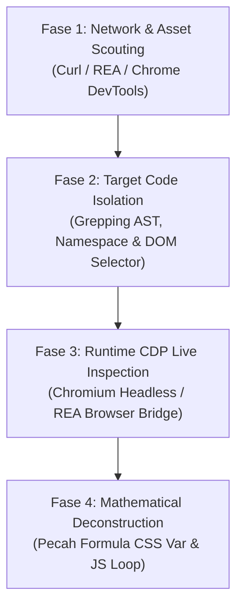

# PANDUAN FUNDAMENTAL REVERSE ENGINEERING FRONTEND MODERN & CREATIVE DEV
> **Lokasi File**: `/home/saifmpleh/Downloads/Telegram Desktop/proyekmagang/REVERSE_ENGINEERING_PLAYBOOK.md`  
> **Tujuan**: Panduan standar (SOP) untuk mendekonstruksi, mengisolasi logika, membongkar matematika animasi, dan mengadopsi fitur dari website kelas dunia mana pun (*Awwwards SOTD, FWA, GSAP, Three.js, Canvas, CSS 3D*) ke dalam proyek kita secara presisi 1:1.

---

## 1. MENTAL MODEL & PILIHAN TOOLSET: KAPAN PAKAI REA VS NATIVE CDP/CLI?

Kemarin Anda merekomendasikan repository **REA (`morluto/rea`)**. Mengapa kemarin untuk Wodniack kita mengombinasikan CLI/CDP langsung dan di mana posisi REA? Berikut perbandingannya:

### Perbandingan Alat: REA vs Native CDP / CLI

| Parameter | **REA (`morluto/rea`)** | **Native CDP & CLI (Metode Sesi Wodniack)** |
| :--- | :--- | :--- |
| **Fokus Utama** | **Full-Stack Reverse Engineering**: Binary (Hopper/Ghidra/IDA), Electron apps, APK (JADX), WASM/WAT, .NET CIL, Go/Rust binaries, dan website network inspection. | **Surgical Frontend Creative Engineering**: Ekstraksi aset bundler (Astro/Vite), dekonstruksi matriks transformasi CSS 3D, dan audit tipografi live. |
| **Kapan Sangat Cocok?** | Ketika target menggunakan **WASM**, binary backend, aplikasi Electron desktop terenkripsi, obfuskator tingkat tinggi, atau analisis payload jaringan kompleks. | Ketika target adalah **situs web murni** dengan animasi CSS/JS modern, GSAP timeline, canvas grid, dan SVG mask. |
| **Setup Overhead** | Memerlukan `npx rea-agents setup`, MCP server registration, dan engine decompiler eksternal. | **Zero setup**: Cukup Node.js native (`fetch` + built-in `WebSocket`), `curl`, dan Chromium headless. |

> [!TIP]
> **Rekomendasi Best Practice**:  
> - Gunakan **REA** sebagai *suite* menyeluruh saat berhadapan dengan target kompleks lintas platform (WASM, Electron, APK, Reverse Engineering API terproteksi).  
> - Gunakan **Native CDP & CLI** untuk investigasi visual cepat, inspeksi layout matematis, dan sinkronisasi sub-pixel animasi web.

---

## 2. SETUP & CARA MENGGUNAKAN REA (`morluto/rea`) UNTUK WEB ANALYSIS

Jika Anda ingin menggunakan REA untuk menganalisis website target:

### 2.1. Instalasi & Registrasi MCP REA
Jalankan setup wizard REA:
```bash
npx rea-agents setup
```
Setup ini akan mendaftarkan MCP server REA ke agent (Antigravity, Claude Code, Cursor, Gemini CLI) dan menyertakan modul:
- `website-analysis`: Struktur halaman, script tree, network observation, dan capture screenshot.
- `javascript-application-workflows`: Analisis AST modul JS, dependensi bundler, route mapping, dan source-map recovery.

### 2.2. Workflow REA untuk Inspeksi Website
```bash
# Contoh pemanggilan analisis static JS bundle via REA CLI/MCP
npx rea-agents analyze-web --url "https://target-site.com" --extract-scripts --dump-ast
```

---

## 3. UNIVERSAL 4-PHASE REVERSE ENGINEERING WORKFLOW



---

## FASE 1: NETWORK & ASSET SCOUTING (PENGAMBILAN ASSET)

Ketika ingin membedah sebuah situs `https://target-site.com`:

### 1.1. Identifikasi Bundler & Entry Files
Jalankan inspeksi cepat lewat CLI:
```bash
# 1. Cari file JavaScript & CSS yang dimuat
curl -s -L "https://target-site.com" | grep -oE '(src|href)="[^"]*\.(js|css|woff2|wasm)"'

# 2. Download bundle utama untuk dianalisis lokal
curl -s -L "https://target-site.com/_astro/main-bundle.js" > /tmp/target_bundle.js
curl -s -L "https://target-site.com/_astro/main-style.css" > /tmp/target_style.css
```

### 1.2. Download & Bedah File Font Asli (Typography Metrics)
Banyak developer gagal menyamakan tampilan karena font yang dipakai di lokal berbeda advance width-nya.
```bash
# Cek deklarasi font-face di CSS
grep -o '@font-face[^{]*{[^}]*}' /tmp/target_style.css

# Download file font (woff2) jika berlisensi bebas / untuk studi teknis
curl -s -L "https://target-site.com/fonts/TargetFont.woff2" > /tmp/TargetFont.woff2

# Cek metrik font dengan python fonttools (advanceWidth, ascent, descent)
python3 -c "
from fontTools.ttLib import TTFont
font = TTFont('/tmp/TargetFont.woff2')
hmtx = font['hmtx'].metrics
for char in ['W', 'O', 'R', 'K']:
    print(char, hmtx.get(char, 'N/A'))
"
```

---

## FASE 2: TARGET CODE ISOLATION (ISOLASI KODE TARGET)

Bundler modern menggabungkan ratusan file menjadi satu file JS minified raksasa (50.000+ baris). Jangan baca seluruh filenya! Cari jarum di tumpukan jerami dengan cara:

### 2.1. Temukan Hook Unik di DOM
Buka target site di browser, inspect element pada komponen yang ingin ditiru, lalu catat:
- **Class name unik**: misal `.s-work`, `.gallery-3d`, `.magnetic-btn`
- **Data attribute**: misal `data-scroll`, `data-cursor`, `data-inertia`
- **ID atau custom element**: misal `<a-work>`, `<canvas-tunnel>`

### 2.2. Gunakan Node.js Script untuk Memotong Blok Kode
```javascript
// scratch/isolate_target.js
const fs = require('fs');
const js = fs.readFileSync('/tmp/target_bundle.js', 'utf8');

// Cari letak selector DOM
const targetHook = 'document.querySelector(".s-work")';
const idx = js.indexOf(targetHook);

if (idx !== -1) {
  // Ambil 200 karakter sebelum dan 4000 karakter sesudah hook
  console.log(js.substring(idx - 200, idx + 4000));
} else {
  console.log('Hook tidak ditemukan, coba cari string class name!');
}
```

---

## FASE 3: RUNTIME CDP LIVE INSPECTION (MENGUKUR METRIK REAL-TIME)

Daripada menebak nilai CSS yang dipengaruhi kalkulasi dinamis, perintahkan Chromium untuk membuka website target dan mencetak nilai *computed style* dan *bounding rect* langsung dari memorinya.

### 3.1. Template Universal Runner CDP (Node.js Native)
Template ini independen tanpa dependency external (cukup Node.js v22+ built-in `fetch` & `WebSocket`):

```javascript
// cdp_live_inspector.js
const http = require('http');
const { spawn } = require('child_process');

async function inspect(targetUrl, evalExpression) {
  // 1. Jalankan headless browser dengan port debug
  const chrome = spawn('chromium', [
    '--headless',
    '--remote-debugging-port=9222',
    '--disable-gpu',
    '--window-size=1280,800',
    '--no-sandbox'
  ]);

  await new Promise(r => setTimeout(r, 1500));

  try {
    // 2. Buka tab baru ke URL target
    const res = await fetch(`http://127.0.0.1:9222/json/new?${encodeURIComponent(targetUrl)}`, { method: 'PUT' });
    const page = await res.json();
    const ws = new WebSocket(page.webSocketDebuggerUrl);
    await new Promise(r => ws.onopen = r);

    let id = 1;
    const send = (m, p={}) => new Promise(resolve => {
      const curId = id++;
      const handler = (e) => {
        const d = JSON.parse(e.data);
        if (d.id === curId) { ws.removeEventListener('message', handler); resolve(d); }
      };
      ws.addEventListener('message', handler);
      ws.send(JSON.stringify({ id: curId, method: m, params: p }));
    });

    await send('Page.enable');
    await send('Runtime.enable');
    
    // Beri waktu 3 detik agar font & animasi JavaScript selesai dimuat
    await new Promise(r => setTimeout(r, 3000));

    // 3. Eksekusi inspeksi di dalam konteks halaman target
    const evaluated = await send('Runtime.evaluate', {
      expression: `JSON.stringify((() => { ${evalExpression} })())`
    });

    console.log("=== HASIL INSPEKSI LIVE ===");
    console.log(JSON.parse(evaluated.result.result.value));

    ws.close();
  } finally {
    chrome.kill();
  }
}

// CONTOH PEMAKAIAN:
// Mengukur font-size, line-height, dan koordinat bounding elemen target
inspect('https://wodniack.dev', `
  const el = document.querySelector('.s-work .s__title');
  const rect = el.getBoundingClientRect();
  const style = getComputedStyle(el);
  return {
    rect: { top: rect.top, height: rect.height, width: rect.width },
    fontSize: style.fontSize,
    lineHeight: style.lineHeight,
    transform: style.transform
  };
`);
```

---

## FASE 4: MATHEMATICAL DECONSTRUCTION (MEMBONGKAR RUMUS)

Semua efek website modern bersandar pada rumus-rumus berikut:

### 4.1. Rumus Normalisasi Progress Scroll
Progress scroll diubah menjadi rentang `0 ke 1` atau `-1 ke 1` (Head):
$$\text{head} = (\text{progress} - 0.5) \times -2$$
- Saat di tengah panggung ($\text{progress} = 0.5$): $\text{head} = 0$.
- Saat di tepi kiri ($\text{progress} = 0.0$): $\text{head} = 1.0$.
- Saat di tepi kanan ($\text{progress} = 1.0$): $\text{head} = -1.0$.

### 4.2. Rumus Parabola Kurva (Bow / Sagging Effect)
Untuk menciptakan kelengkungan silinder 3D:
$$\text{ahead} = \text{head}^2$$
Karena kuadrat bilangan positif maupun negatif selalu positif, nilai `--ahead` membentuk kurva parabola simetris:
- Di tengah: $0^2 = 0$ (tidak ada translasi Y).
- Di tepi kiri/kanan: $1^2 = 1$ (translasi Y maksimal).

Dikalikan dengan indeks baris vertikal $\text{--iy}$:
$$\text{offsetY} = \text{--iy} \times \text{faktor\_kelengkungan} \times \text{--ahead} \times \text{--state}$$
> [!NOTE]
> Jika **faktor kelengkungan** terlalu tinggi ($50\%$), baris huruf akan melorot ekstrem seperti mangkok. Menurunkannya ke $18\%$ mempertahankan kedalaman 3D secara subtle, elegan, dan stabil di mata.

### 4.3. Rumus Dynamic Letter Spacing & Density
Bagaimana membuat jarak celah (*gap*) antar huruf seragam meski hurufnya memiliki lebar berbeda?
$$\text{total\_ghost} = \text{round}\left(\frac{\text{lebar\_kontainer}}{\text{lebar\_huruf}} \times \text{density}\right) + 2$$
- **Huruf kurus (I, O, L)**: Menghasilkan jumlah ghost lebih banyak.
- **Huruf lebar (W, M)**: Menghasilkan jumlah ghost lebih sedikit.
- **Hasil**: Jarak antar huruf (*gap*) di baris huruf gemuk dan baris huruf kurus sama persis (misal sama-sama 35px).

### 4.4. Dead-Center Horizontal Alignment
Jangan pernah mengambil koordinat kiri langsung dari bounding box teks (`i.left = r.left`), karena huruf yang lebih ramping akan ikut rata kiri dan tampak menceng. Selalu gunakan rumus sumbu simetris:
$$\text{i.left} = \frac{\text{lebar\_kontainer}}{2} - \frac{\text{lebar\_huruf}}{2}$$

---

## 5. CHEAT SHEET: DIAGNOSIS BUG REVERSE ENGINEERING

| Gejala Bug | Kemungkinan Penyebab | Cara Mengatasi |
| :--- | :--- | :--- |
| **Spasi / Gap Huruf Tidak Sama** | Font-size diperkecil secara artifisial, atau density bernilai tetap (*hardcoded*). | Kembalikan font-size ke skala viewport asli ($25\text{vh}$). Gunakan formula densitas dinamis: `bounding.width / letter.width * density`. |
| **Huruf Terpotong / Clipping di Mask** | Posisi anchor di-override dengan `top: 50%` atau `52%`, lepas dari flow flexbox. | Biarkan container flexbox mengatur `justify-content: center`, ukur kapsul dari invisible ruler (`80vh`). |
| **Huruf Condong ke Kiri (Align-Left)** | Koordinat diambil dari `r.left` DOM langsung. | Ganti dengan formula pusat simetris: `containerCenterX - (letterWidth / 2)`. |
| **Mata Capek / Visual Noise** | Efek shadow `::before` memiliki offset horizontal yang tumpang tindih dengan huruf tetangga. | Matikan pseudo-element shadow duplikat (`display: none !important;`). |
| **Kurva Melengkung Terlalu Tajam** | Multiplier kurva Y (`--iy * 50% * --ahead`) terlalu tinggi. | Turunkan multiplier ke `15% - 20%` untuk kelengkungan silinder halus. |

---

## 6. LOKASI SCRIPT & REFERENSI DI WORKSPACE INI
- **Buku Panduan Utama**: `/home/saifmpleh/Downloads/Telegram Desktop/proyekmagang/REVERSE_ENGINEERING_PLAYBOOK.md`
- **Kode Produksi Portofolio**: [saif-portfolio/index.html](file:///home/saifmpleh/Downloads/Telegram%20Desktop/proyekmagang/saif-portfolio/index.html)
- **Kode Riset & Backup**: [waskitariset/index.html](file:///home/saifmpleh/Downloads/Telegram%20Desktop/proyekmagang/waskitariset/index.html)
- **CDP Inspector Tool**: [scratch/take_work_screenshot.js](file:///home/saifmpleh/.gemini/antigravity/brain/2c867f8a-2c8c-44ad-a4aa-877dafc525ab/scratch/take_work_screenshot.js)
