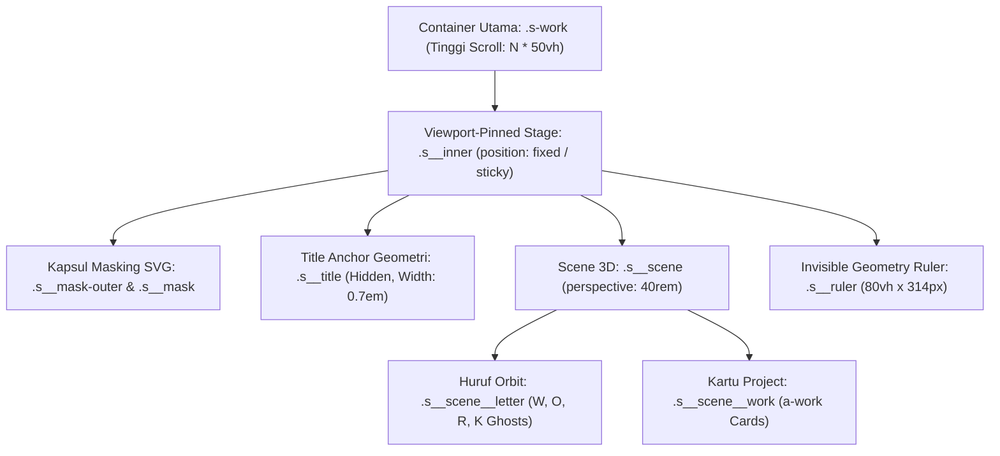

# Panduan & Dokumentasi Reverse Engineering: 3D Cylindrical Marquee (Wodniack.dev)

Dokumentasi ini merangkum metodologi teknis, alur investigasi, formula matematika, dan penyelesaian bug saat melakukan *reverse engineering* fitur 3D Cylindrical Marquee dari situs referensi kelas dunia (**[wodniack.dev](https://wodniack.dev)**) ke dalam portofolio modern.

---

## 1. Metodologi Reverse Engineering Frontend Modern (Astro / Vite / Webpack)

Situs modern umumnya menggunakan bundler (*Astro, Vite, esbuild*) yang melakukan *minification* dan *tree-shaking*. Berikut langkah sistematis untuk membongkarnya tanpa *source maps*:

### A. Ekstraksi Asset Bundler Langsung dari Production
1. **Inspeksi Script & Stylesheet Entry**:
   ```bash
   curl -s -L "https://wodniack.dev" | grep -o 'src="[^"]*\.js"'
   curl -s -L "https://wodniack.dev" | grep -o 'href="[^"]*\.css"'
   ```
2. **Download Bundled Asset untuk Analisis Lokal**:
   ```bash
   curl -s -L "https://wodniack.dev/_astro/hoisted.BvNyQ0G_.js" > /tmp/wodniack_hoisted.js
   curl -s -L "https://wodniack.dev/_astro/index.MJ9FiCyD.css" > /tmp/wodniack_index.css
   ```

### B. Isolasi Komponen Target Menggunakan Query String AST / Regex
Alih-alih membaca jutaan karakter minified code sekaligus, isolasi namespace komponen (misal `.s-work`):
```javascript
// Script Node.js untuk mengekstrak class controller s-work
const fs = require('fs');
const js = fs.readFileSync('/tmp/wodniack_hoisted.js', 'utf8');
const idx = js.indexOf('document.querySelector(".s-work")');
console.log(js.substring(idx - 100, idx + 3500));
```

### C. Live Runtime Inspection Menggunakan CDP (Chrome DevTools Protocol)
Metode paling akurat untuk mengukur nilai komputasi *real-time* (bounding rect, font computed style, dsb.) secara otomatis menggunakan Chromium Headless:
```javascript
// Menjalankan Chromium headless dengan remote debugging port
const chrome = spawn('chromium', [
  '--headless',
  '--remote-debugging-port=9222',
  '--disable-gpu',
  '--window-size=1280,800'
]);

// Membuka tab WebSocket CDP ke live site
const res = await fetch('http://127.0.0.1:9222/json/new?https://wodniack.dev/', { method: 'PUT' });
const page = await res.json();
const ws = new WebSocket(page.webSocketDebuggerUrl);

// Eksekusi Runtime.evaluate untuk membaca nilai aktual
const evalResult = await send('Runtime.evaluate', {
  expression: `(() => {
    const letters = Array.from(document.querySelectorAll('.s-work .s__title .js-letter'));
    return letters.map(l => ({
      char: l.innerText,
      rect: l.getBoundingClientRect(),
      font: getComputedStyle(l).font,
      lineHeight: getComputedStyle(l).lineHeight
    }));
  })()`,
  returnByValue: true
});
```

---

## 2. Arsitektur Komponen 3D Cylindrical Marquee

Sistem panggung 3D terdiri dari 4 lapisan utama:



---

## 3. Rahasia Matematika & Formula Wodniack

### A. Tipografi & Skala Vertikal Proporsional
Agar huruf mengisi layar secara megah tanpa terpotong (*no clipping*):
- **Font Size**: `min(18.75rem, 25vh) / 1` (sekitar $25\%$ tinggi viewport).
- **Line Height**: `0.85`.
- **Tinggi Tiap Huruf**: $25\text{vh} \times 0.85 \approx 21.25\text{vh}$.
- **Tinggi Total 4 Baris (W-O-R-K)**: $4 \times 21.25\text{vh} = 85\text{vh}$.
- **Sisa Headroom Atas & Bawah**: $\frac{100\text{vh} - 85\text{vh}}{2} = 7.5\text{vh}$ (simetris di tengah).

### B. Formula Densitas & Kerenggangan Dinamis (Spacing)
Alih-alih meng-hardcode jumlah huruf yang menyebabkan huruf tumpang tindih (*visual fatigue*) atau terlalu bolong, gunakan perbandingan lebar fisik glyph:

$$\text{total} = \text{round}\left(\frac{\text{bounding.width}}{\text{letter.width}} \times \text{density}\right) + 2$$

- **Density Desktop**: `0.75`
- **Density Mobile**: `0.50`

| Huruf | Advance Width | Total Ghost di Orbit | Tampak di Layar | Jeda Napas (*Gap*) |
| :---: | :---: | :---: | :---: | :---: |
| **W** | $\approx 103\text{px}$ (Lebar) | $10\text{ ghosts}$ | $\approx 7\text{ huruf}$ | $\approx 35\text{px}$ bersih |
| **O** | $\approx 65\text{px}$ (Ramping) | $16\text{ ghosts}$ | $\approx 11\text{ huruf}$ | $\approx 35\text{px}$ bersih |
| **R** | $\approx 65\text{px}$ (Ramping) | $16\text{ ghosts}$ | $\approx 11\text{ huruf}$ | $\approx 35\text{px}$ bersih |
| **K** | $\approx 70\text{px}$ (Sedang) | $15\text{ ghosts}$ | $\approx 10\text{ huruf}$ | $\approx 35\text{px}$ bersih |

> [!TIP]
> Formula dinamis ini otomatis menyesuaikan jumlah ghost berdasarkan lebar masing-masing karakter, menghasilkan jarak celah (*horizontal negative space*) yang identik di setiap baris.

### C. Kurva Silinder 3D (*Perspective & Subtle Orbit Bow*)
Animasi rotasi dan translasi silinder diatur dengan CSS Variables:

```css
.s-work .s__scene .s__scene__letter {
  --head: calc((var(--progress) - 0.5) * -2);
  --ahead: calc(var(--head) * var(--head));
  position: absolute;
  top: 0;
  left: 0;
  display: block;
  text-align: center;
  transform: rotateY(calc(var(--head) * -10deg * var(--state))) 
             translate3d(calc(var(--head) * 50vw * var(--state)),
                         calc(var(--iy) * 18% * var(--ahead) * var(--state)), 0);
  pointer-events: none;
  will-change: transform;
}
```

- `--head`: Bernilai `1` di ujung kiri, `0` di tengah, dan `-1` di ujung kanan.
- `--ahead`: Bernilai kuadrat (`head^2`), menghasilkan kurva parabola halus.
- `--iy`: Koordinat indeks baris:
  $$\text{--iy} = \left(\frac{s + 1}{N + 1} - 0.5\right) \times 2$$
  - W: `-0.6`
  - O: `-0.2`
  - R: `+0.2`
  - K: `+0.6`
- **Faktor Kelengkungan Vertikal**: Gunakan `18%` (bukan `50%`). Nilai `18%` menjaga kelengkungan tetap subtle, anggun, dan tidak melorot seperti mangkok.

---

## 4. Troubleshooting & Pelajaran Penting (*Pitfalls & Fixes*)

### Kasus 1: Mengapa Mengubah Jarak Saja Tidak Pernah Pas Jika Ukuran Font Salah?
- **Masalah**: Font sempat diturunkan ke `21.5vh` agar huruf W tidak ketutupan.
- **Akibat**: Saat ukuran font mengecil, rasio aspek glyph berubah terhadap ukuran layar, menyebabkan kalkulasi pembagian spasi meleset dan huruf terlihat kurus/kopong.
- **Solusi**: Jangan pernah mengecilkan font jika ingin proporsi identik. Pertahankan `25vh`, lalu selesaikan masalah headroom melalui posisi kontainer dan ukuran kapsul (`.s__ruler`).

### Kasus 2: Penyakit Align-Left pada Huruf
- **Masalah**: Kode asli Wodniack menggunakan `i.left = r.left`.
- **Akibat**: Karena lebar huruf W (103px) jauh lebih lebar daripada O (65px), pembacaan `r.left` DOM membuat semua huruf rata kiri di dalam kapsul, sehingga huruf O, R, K condong ke kiri.
- **Solusi**: Hitung titik tengah kapsul secara independen:
  ```javascript
  const containerCenterX = this.bounding.width / 2;
  i.left = containerCenterX - (i.width / 2);
  ```

### Kasus 3: Visual Noise dari Lapisan Shadow Ekstrusi
- **Masalah**: Efek shadow `::before` yang memiliki offset horizontal menimbulkan tumpukan segitiga hitam acak saat huruf berjejer, membuat mata cepat lelah (*chromatic & accommodation fatigue*).
- **Solusi**: Matikan shadow duplikat (`display: none !important;`) untuk mendapatkan tipografi bersih (*clean editorial typography*).

---

## 5. Ringkasan File Terkait

1. **Kode Utama**: [saif-portfolio/index.html](file:///home/saifmpleh/Downloads/Telegram%20Desktop/proyekmagang/saif-portfolio/index.html)
2. **File Sinkronisasi**: [waskitariset/index.html](file:///home/saifmpleh/Downloads/Telegram%20Desktop/proyekmagang/waskitariset/index.html)
3. **Commit Terakhir**: `11c9e8d` di repositori GitHub `main`.
